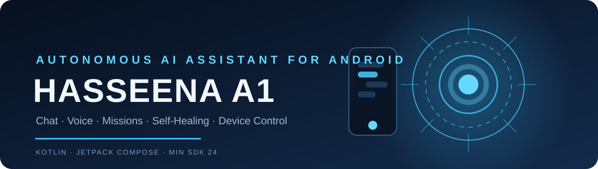
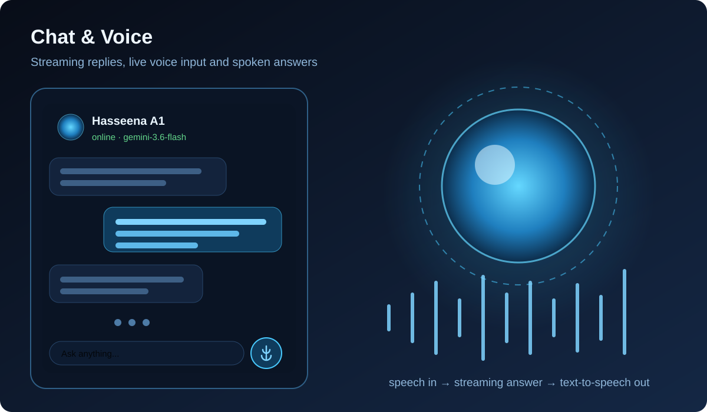
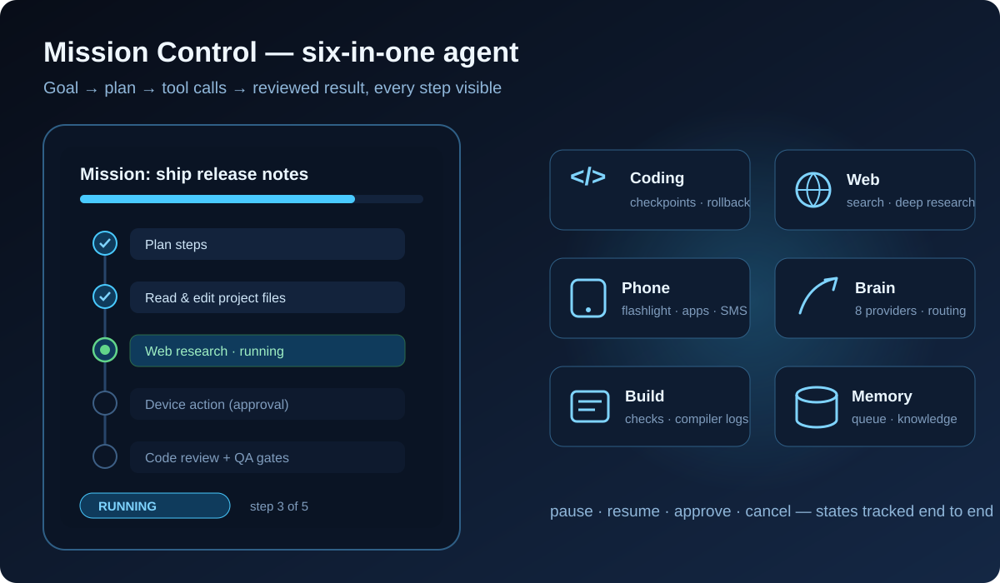
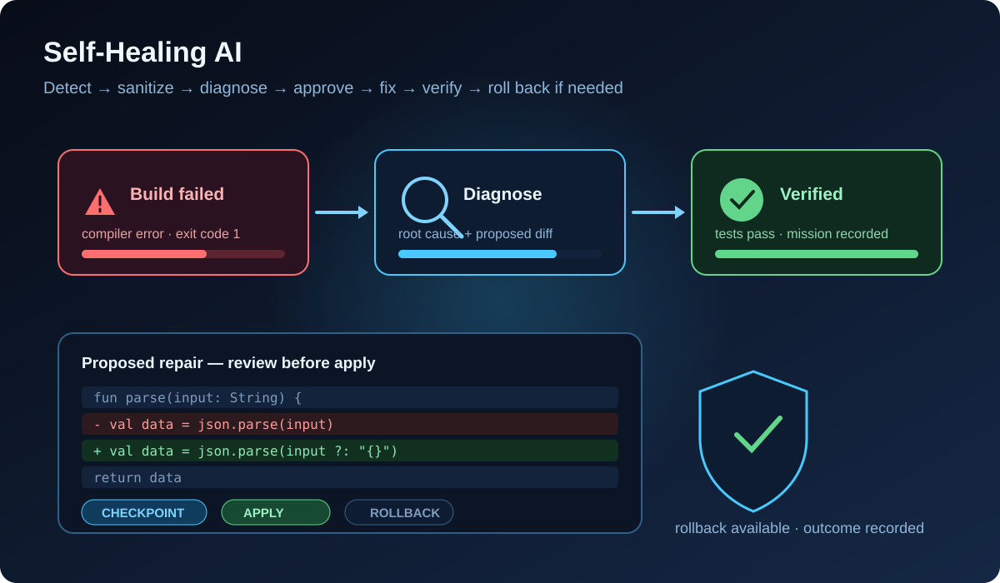
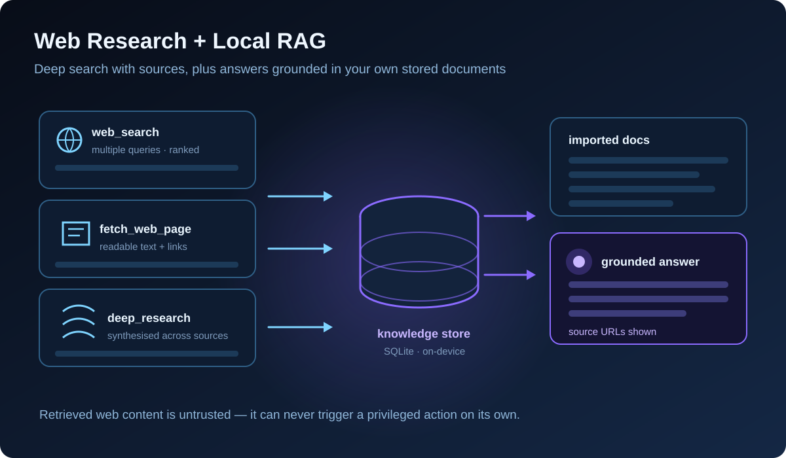
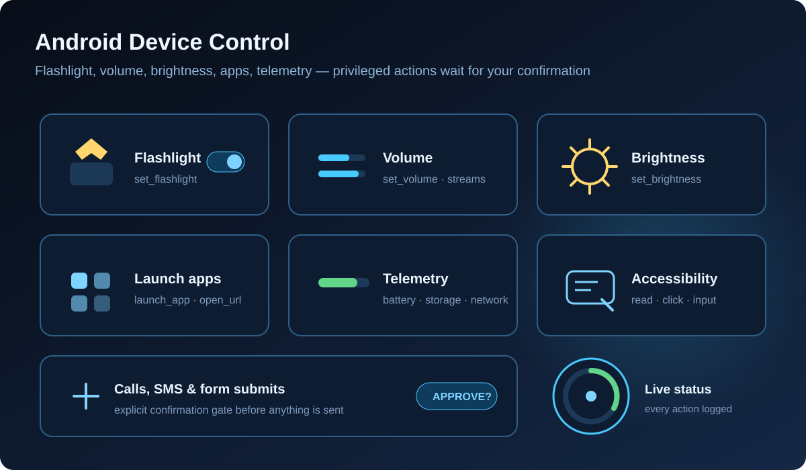
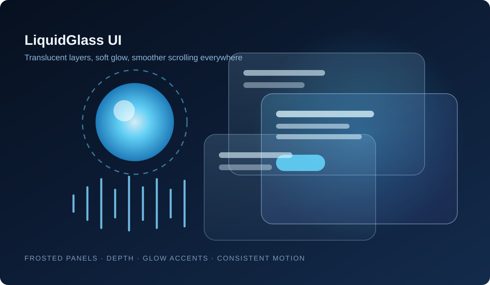
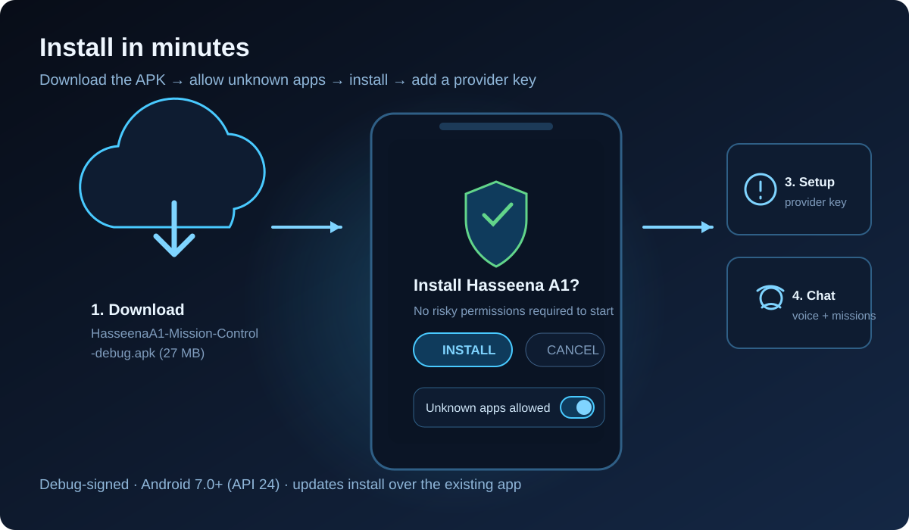

<div align="center">

# 🤖 HASSEENA A1

**A native Android AI assistant — chat, voice, autonomous missions,
self-healing code repairs and full device control.**

*Turn a goal into a plan, let six tool domains execute it, and review
every step — all from your phone.*

[-3DDC84?logo=android&logoColor=white)](https://www.android.com/)
[](https://kotlinlang.org/)
[](https://developer.android.com/jetpack/compose)
[](https://github.com/shahid-boop/Hassena0.5/releases/tag/v2.0)
[](https://github.com/shahid-boop/Hassena0.5/releases/download/v2.0/HasseenaA1-Mission-Control-debug.apk)

<a href="https://github.com/shahid-boop/Hassena0.5/releases/download/v2.0/HasseenaA1-Mission-Control-debug.apk">

</a>



</div>

---

## ✨ Features

### 🗣️ Chat, Voice & 3D Avatar



- **Streaming AI chat** with copy / share / speak / retry actions and
  model indicators.
- **Voice input** via Android speech recognition with live partial
  transcripts; **voice output** through system TTS or an ElevenLabs
  integration path.
- Listening → thinking → speaking → idle **state feedback** and a
  sci-fi **3D animated avatar** (`avatar3d` assets).
- Floating **scroll-to-bottom** control that only appears when the
  list is out of view.

### 🤖 Six-in-One Autonomous Agent (Mission Control)



A supervisor turns one goal into ordered steps, picks the right tool,
collects results and reports back — with status tracking
(`PENDING → PLANNING → RUNNING → PAUSED → WAITING_FOR_PERMISSION →
COMPLETED / FAILED / CANCELLED`):

1. **AI coding & project editing** — read / list / write / move project
   files with pre-edit **checkpoints**, `propose_code_refactor` diffs,
   `rollback_file_checkpoint` and changed-file tracking.
2. **Build & test executor** — `run_build_check`, `run_unit_tests`,
   `parse_compiler_log` (routes failures into self-healing) and
   `verify_apk_artifact`.
3. **Internet & browser automation** — `web_search`, `deep_research`,
   `fetch_web_page` with readable-text extraction and confirmation
   gates on form submissions.
4. **Android phone actions** — accessibility read/click/input/global
   actions, device telemetry (battery, storage, network), flashlight,
   volume, brightness, `launch_app`, `open_url`, installed-app listing,
   notification reading, timers — and **calls / SMS only after explicit
   user confirmation**.
5. **Persistent memory & task queue** — mission records, pause / resume
   / retry / cancel, local `search_knowledge`, `save_memory` and
   credential redaction from logs.
6. **AI brain & model routing** — routes across **Gemini, OpenAI, Groq,
   Anthropic Claude, Mistral, Perplexity, OpenRouter and NVIDIA NIM**,
   with step planning, bounded re-planning on errors and
   `synthesize_report` summaries.

### 🩹 Self-Healing AI



Detect → **sanitize secrets** → diagnose → propose a fix → **user
approval** → checkpoint → apply → verify → recover or **roll back** →
record the outcome. Repairs only ever marked resolved when
verification actually succeeds.

### 🌐 Web Research + Local RAG



- Multi-query deep research with **source URLs** shown for every answer.
- **SQLite-backed knowledge store**: import documents, retrieve relevant
  snippets and ground answers in your own local content.

### 📱 Device Control & Smart Permissions



- Flashlight, volume, brightness, app launcher, URLs, timers, device
  telemetry.
- Optional **Accessibility Service**, **Notification Access** and
  **overlay** — enable only what you use, everything privileged sits
  behind a **confirmation gate**.

### 🧠 Local Memory & Task Queue
Everything stays on-device in a SQLite `HasseenaDatabase`: chat
history, approved memory facts, response cache, automations,
knowledge items, agent steps, error & repair history. Non-destructive
migrations only — your data survives upgrades.

### 🎨 LiquidGlass Design System



Latest UI refresh: modern translucent "LiquidGlass" styling, improved
scroll behavior and layout padding across chat, missions and home.

---

## 📥 Download

> ### ⬇ [Direct APK download — Hasseena A1 v2.0 (27 MB)](https://github.com/shahid-boop/Hassena0.5/releases/download/v2.0/HasseenaA1-Mission-Control-debug.apk)

| Build | Size | Notes |
|---|---|---|
| **[HasseenaA1-Mission-Control-debug.apk](https://github.com/shahid-boop/Hassena0.5/releases/download/v2.0/HasseenaA1-Mission-Control-debug.apk)** | 27.4 MB | ✅ **Latest** — LiquidGlass UI (Nov 2026) |

**Install (sideload):**

1. Download the APK on your Android phone (tap the button above).
2. When prompted, allow **"Install unknown apps"** for your browser /
   file manager.
3. Open the downloaded file → **Install** → launch **Hasseena A1**.
4. Add an AI provider key (see below) and start chatting.



> Debug-signed build, `minSdk 24` (Android 7.0+). To update later,
> install the new APK over the old one (same signing key).

---

## ⚙️ Setup

### 1. AI provider key (required for real answers)
Open the **Providers / Settings** screen in the app and enter the
credentials for a provider you have (Gemini, OpenAI, Groq, OpenRouter,
Mistral, Claude, Perplexity, NVIDIA NIM — whatever the build
supports). Test with a short message before starting a long mission.

Building from source? Copy `.env.example` → `.env` and fill **only**
the variables you need — never commit `.env`, keystores or real keys.

### 2. Optional Android services (enable only what you need)
| Service | Needed for |
|---|---|
| Microphone permission | Voice input / voice mode |
| Accessibility Service | Screen reading & UI actions |
| Notification Access | Reading notifications |
| Display-over-other-apps | Floating assistant overlay |
| Contacts / phone / SMS | Confirmation-gated calls & messages |

### 3. First mission
Type a goal in **Mission Control** → the agent plans steps → approve
where prompted → watch each step's live status → review the final
summary and changed files.

---

## 🛠️ Build from source

```bash
git clone https://github.com/shahid-boop/Hassena0.5.git
cd Hassena0.5
```

Open the repo in **Android Studio**, let Gradle sync finish, then:

```bash
./gradlew :app:assembleDebug        # Windows: gradlew.bat :app:assembleDebug
# → app/build/outputs/apk/debug/app-debug.apk
```

Run the unit tests:

```bash
./gradlew :app:testDebugUnitTest    # Windows: gradlew.bat :app:testDebugUnitTest
```

**Requirements:** Android Studio / compatible Gradle + JDK, Android SDK
for `compileSdk 36`, internet for dependencies and provider calls, and
a device or emulator for runtime checks.

---

## 📂 Repository structure

```
Hassena0.5/
├── app/src/main/java/com/example/
│   ├── MainActivity.kt
│   ├── models/  providers/          # data models + AI provider routing
│   ├── services/
│   │   ├── accessibility/           # screen reading & UI actions
│   │   ├── agent/                   # autonomous mission engine
│   │   ├── healing/                 # self-healing workflow
│   │   └── memory/                  # SQLite memory & task queue
│   └── ui/features/                 # chat, agent, healing, home screens
├── app/src/main/assets/avatar3d/    # 3D avatar assets
├── docs/images/                     # graphics
├── gradle/                          # version catalog
├── .env.example                     # provider variable template
├── MOBILE_CORE_PROTOCOL.md          # protocol reference
└── HasseenaA1-Mission-Control-debug.apk   # ready-to-install build
```

## 🛠️ Technology stack

**Kotlin** · **Jetpack Compose** · Coroutines · Kotlin serialization ·
OkHttp + Retrofit · Room/SQLite · Android SpeechRecognizer + TTS ·
Accessibility Service · Robolectric + JUnit · Gradle version-catalog.

---

## ⚠️ Permissions & privacy

- Uses **network, microphone, camera/flashlight, notifications,
  accessibility** and — only if you enable them — contacts, phone and
  SMS related actions.
- Consequential actions (calls, messages, form submission, destructive
  file edits) always wait for **your confirmation**.
- Credentials are redacted from logs; **never store API keys or
  passwords as "memories"**.
- Retrieved web content is untrusted input — it can never authorize a
  privileged action on its own.
- Disable optional services (accessibility, notification access) any
  time you no longer need them.

## 🧪 Known limitations

- External providers need valid credentials, connectivity and quota —
  a provider listed in the docs may not be enabled in every build.
- Device actions are bounded by Android OS restrictions, hardware and
  granted permissions; protected screens may refuse accessibility
  actions.
- Self-healing diagnoses and repairs **best-effort** — it reports
  honestly when verification is unavailable or a repair fails.
- RAG answers depend on what you actually imported and indexed.
- This is a **debug-signed** build; it may not install as an update
  over a differently signed install.

---

## 📄 License

No `LICENSE` file is published yet — all rights reserved by the
author until one is added. Do not assume MIT/Apache terms.

<div align="center">

**Hasseena A1 — build carefully, verify real behavior, protect user
data.**

[Download the APK](https://github.com/shahid-boop/Hassena0.5/releases/download/v2.0/HasseenaA1-Mission-Control-debug.apk) ·
[Releases](https://github.com/shahid-boop/Hassena0.5/releases) ·
[Commit history](https://github.com/shahid-boop/Hassena0.5/commits/main)

</div>
